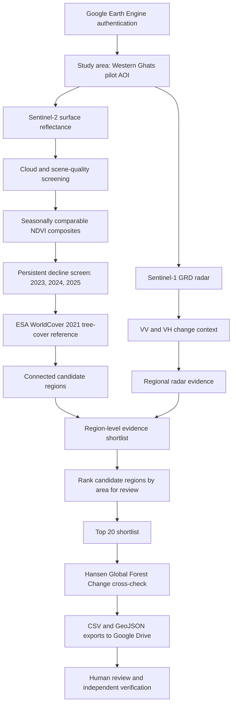

# ForestWatch AI — system architecture

## Processing flow

## Components and responsibilities

| Component | Role | Interpretation |
|---|---|---|
| Sentinel-2 SR Harmonized | NDVI observations from optical bands | Vegetation-condition indicator; sensitive to clouds and seasonal effects |
| Quality screening | Masks poor-quality observations and requires repeat observations | Reduces, but does not eliminate, observation artefacts |
| Multi-year comparison | Compares corresponding seasonal windows across 2023–2025 | Persistent decline is a screening signal, not a forest-loss label |
| Sentinel-1 GRD | VV/VH radar change context | Complementary evidence; backscatter changes are not uniquely attributable |
| ESA WorldCover 2021 | Historical tree-cover reference (class 10) | Helps screen to areas mapped as tree cover; does not prove natural forest |
| Connected regions | Groups adjacent candidate pixels and filters tiny fragments | Creates reviewable geographic units |
| Hansen Global Forest Change | Independent, coarser loss-year cross-check | Indicates mapped stand-replacement loss, not its cause or legality |
| CSV / GeoJSON export | Makes shortlist reusable in analysis and mapping tools | Exports candidates for human review |

## Evidence logic

ForestWatch separates three concepts:

1. **Candidate generation:** persistent optical vegetation decline in the selected seasonal windows.
2. **Evidence context:** radar support and historical tree-cover / forest-loss references.
3. **Review priority:** region size and measured evidence used to order areas for inspection.

These are not a calibrated probability model. A high-ranked region is not necessarily illegal deforestation, and a low-ranked or unflagged region is not guaranteed to be unchanged.

## Human review

Before a candidate is described as forest loss, a reviewer should inspect dated imagery, local land-cover context, known plantations and land management, fire or storm history, and authoritative ground/reference information. Any enforcement decision requires competent authorities and independent verification.
